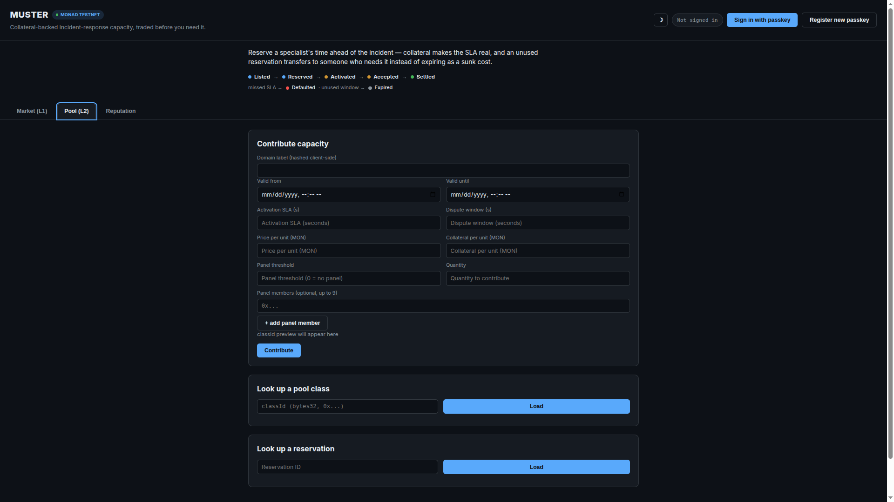
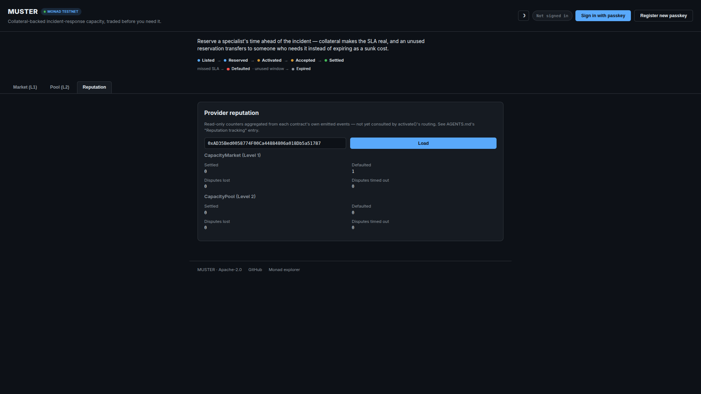
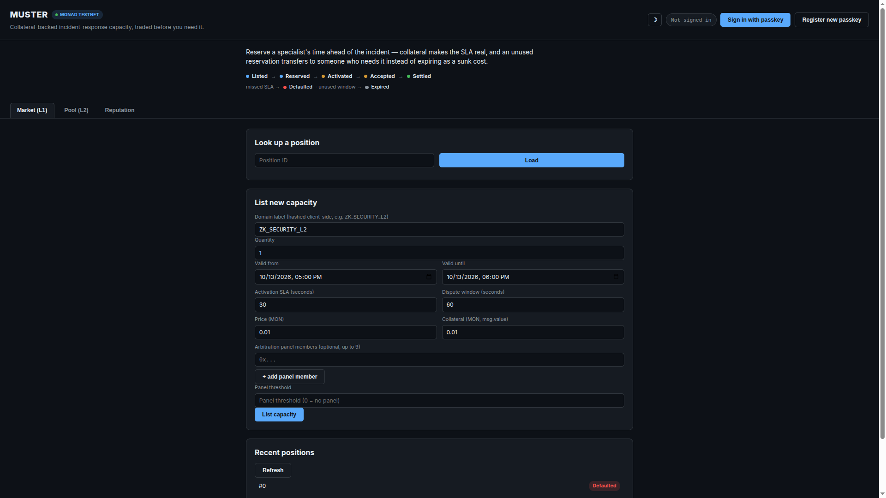
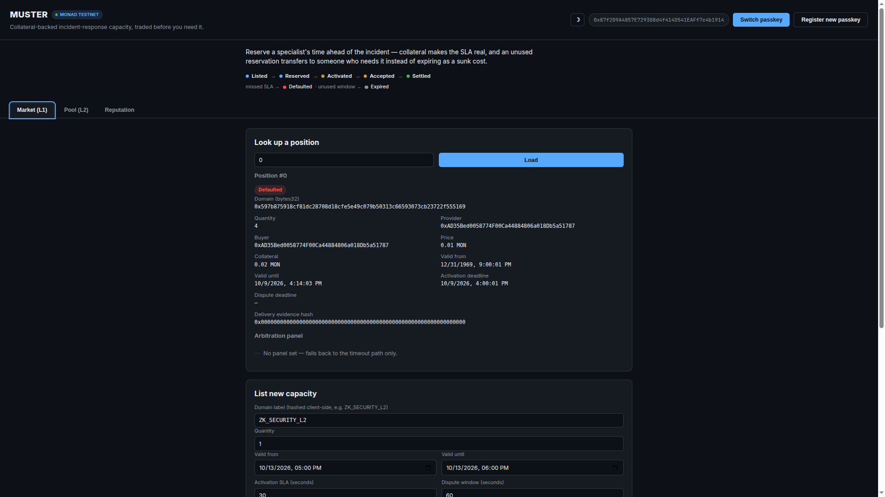

<p align="center"><a href="README.md"><strong>English</strong></a> · <a href="README_ES.md"><strong>Español</strong></a> · <a href="docs/TECHNICAL_README.md"><strong>Technical README</strong></a> (arquitectura, invariantes y evidencia)<br><a href="https://muster-dapp.vercel.app"><strong>→ Aplicación en vivo</strong></a> · <a href="docs/USAGE_GUIDE.md">Guía en inglés para jueces</a> · <a href="docs/GUIA_DE_USO_ES.md">Guía en español para revisión</a> · <a href="https://muster-pitch.vercel.app"><strong>Página de presentación</strong></a> · <a href="docs/BUSINESS_CASE.md">Caso de negocio</a></p>

<p align="center"></p>

# MUSTER

El problema es **la plata, la disponibilidad y la urgencia**. Tener peritos forenses en relación de dependencia implica pagar salarios aunque no haya un caso que requiera su trabajo. Un abono mensual también cuesta aunque esa disponibilidad quede ociosa. Pero cuando sí ocurre un incidente, quizá no haya nadie disponible; encontrar a alguien mientras el caso avanza obliga a buscar y negociar bajo presión.

**MUSTER propone un mercado compartido para reservar capacidad profesional por adelantado.** El comprador reserva un bloque definido para una ventana futura, con precio y SLA de respuesta respaldado por colateral. En el pool, ese bloque puede cubrirse con aportes de distintos proveedores que aceptaron las mismas condiciones. El primer caso de uso es la respuesta forense a incidentes; la misma estructura podría servir para contadores, albañiles u otros profesionales cuyo trabajo se necesita de manera imprevisible.

Si el comprador finalmente no necesita la reserva, puede transferir a otro comprador el derecho a usarla antes de que venza. Así tiene la opción de pasarla antes de que caduque; si nadie la transfiere o activa a tiempo, se aplican las reglas de vencimiento del contrato. En los contratos actuales, la transferencia cambia quién puede activar la reserva: MUSTER no procesa el pago de reventa ni devuelve automáticamente el dinero al comprador original. Las partes acuerdan entre ellas cualquier compensación.

## Qué hace

Un perito forense podría comprometerse, por ejemplo: *«reservo cuatro horas para respuesta a incidentes entre el 1 y el 31 de octubre y confirmo una activación en un máximo de 30 minutos»*. Los contratos actuales representan estos compromisos como unidades de capacidad con una ventana, un precio, un SLA de respuesta y colateral; no miden las horas de trabajo fuera de la cadena ni certifican credenciales profesionales. La oferta se convierte en una posición onchain con dueño, ventana de disponibilidad, precio, plazo de respuesta y colateral.

El comprador reserva la posición antes de que ocurra un incidente. Si lo necesita durante la ventana acordada, la activa y empieza a correr el SLA de respuesta del proveedor. El colateral respalda ese plazo; no demuestra que el trabajo fuera de la cadena se haya realizado ni que cumpla un estándar de calidad.

```text
ANTES DEL CASO          SI EL CASO OCURRE          SI NO HACE FALTA
reservar un bloque ────▶ activar; empieza el SLA
                        de respuesta
                      └─────────────────────────▶ transferir el derecho
                                                   antes del vencimiento
```

## Más allá de la forense: un mercado para distintos oficios

La forense es el primer ejemplo, no el límite de la idea. El mismo problema
aparece cuando la demanda es irregular: puede ser difícil justificar un
salario o abono recurrente, y también encontrar a alguien calificado justo
cuando hace falta.

| Rubro posible | Ejemplo de capacidad reservable |
|---|---|
| Forense y respuesta a incidentes | Un bloque de tiempo de respuesta especializada dentro de una ventana acordada |
| Contabilidad | Ayuda para un cierre, una auditoría o una fecha límite impositiva sin contratar a alguien de forma permanente |
| Albañilería y otros oficios | Disponibilidad para una reparación o un trabajo chico con fecha urgente |
| Otros servicios profesionales | Cualquier servicio cuyas unidades, ventana, precio y condiciones de respuesta puedan acordarse de antemano |

`CapacityPool` permite formar una “bolsa de profesionales”: el comprador
reserva unidades bajo una misma clase de condiciones y, al activar, el
contrato puede distribuirlas entre proveedores que aceptaron esas mismas
condiciones. Un nuevo rubro puede usar otro dominio y otras condiciones sin
agregar lógica específica para esa profesión. La demo actual ejercita la
respuesta forense/de seguridad; los demás son rubros posibles, todavía no
categorías de servicio activas en el despliegue. Los contratos no verifican
matrículas, horas trabajadas ni calidad de obra: cada mercado debe resolver
la selección y evaluación de sus profesionales por fuera de la cadena.
| En un acuerdo informal | En MUSTER |
|---|---|
| Salarios o abonos mensuales pagan capacidad aunque quede ociosa | Se reserva un bloque definido para una ventana futura, sin tener al profesional a tiempo completo en espera |
| Durante el incidente hay que buscar a alguien libre y negociar bajo presión | Proveedor, precio y SLA de respuesta se acuerdan por adelantado |
| Una reserva sin uso vence sin poder pasarla a otra persona | El derecho a activarla se puede transferir antes del vencimiento; la reventa se acuerda entre compradores |
| Un único proveedor puede no estar disponible cuando hace falta | `CapacityPool` puede asignar la reserva entre proveedores que aceptaron las mismas condiciones |
| «Confiá en que estaba disponible» | La cadena registra cuándo se reservó, transfirió, activó, aceptó y liquidó o declaró en default |

## Cómo funciona

Una posición individual recorre este ciclo:

```text
LISTED → RESERVED → ACTIVATED → ACCEPTED → DELIVERY CLAIMED → SETTLED
            │            │                         │
            │            └─ vence el SLA → DEFAULTED
            └─ vence sin activarse → EXPIRED
```

Antes de cobrar, el proveedor registra una afirmación de entrega con un hash de la evidencia. El comprador puede aceptarla o disputar la entrega dentro de una ventana limitada. Hay rutas de timeout para que el silencio de cualquiera de las partes no bloquee fondos indefinidamente. El arbitraje por panel es opcional; el contrato no garantiza que sus integrantes sean independientes. El [README técnico](docs/TECHNICAL_README.md) describe las reglas de pago, invariantes y límites de confianza.

## Contratos e integraciones

**CapacityMarket** gestiona posiciones de un proveedor. **CapacityPool** agrupa capacidad fungible bajo una misma clase de condiciones: el comprador reserva una cantidad sin elegir proveedor y la activación la asigna en orden FIFO. Cada parte asignada tiene su propio ciclo de aceptación, entrega, disputa y liquidación; el default de un proveedor no cancela las asignaciones de los demás.

- **Chainlink CRE:** un workflow programado busca plazos vencidos y envía un reporte a un dispatcher cerrado que solo permite seis acciones conocidas sobre los dos contratos. El default de la posición de ejemplo se ejecutó mediante este flujo.
- **Envio HyperIndex:** indexa los eventos de ambos contratos y las estadísticas de proveedores para consultarlas por GraphQL.
- **Mera:** permite firmar desde la aplicación usando una passkey, sin extensión de wallet ni frase semilla.
- Las estadísticas de resultados por proveedor son informativas y no alteran el orden FIFO.

## Implementación y evidencia

Solidity y Foundry para los contratos; TypeScript para la aplicación web y el workflow CRE; Vite para compilar la aplicación, desplegada en Vercel; Monad testnet para los contratos y la demo.

El proyecto documenta 118 pruebas Solidity y 5 pruebas del workflow CRE. Cubren los ciclos e invariantes descritos en sus suites; no constituyen una prueba de corrección general. La auditoría adversarial de los niveles 4/5 y CRE está en [docs/SECURITY_AUDIT_ROUND2_2026-10-05.md](docs/SECURITY_AUDIT_ROUND2_2026-10-05.md).

### Contratos actuales en Monad testnet

| Contrato | Dirección |
|---|---|
| CapacityMarket | [0xb2bEed70CA03F9ae86276f14aAB79F6F36f681C3](https://testnet.monadexplorer.com/address/0xb2bEed70CA03F9ae86276f14aAB79F6F36f681C3) |
| CapacityPool | [0xA5460952b9445C2CC5daf08D4808C09f4458Aa11](https://testnet.monadexplorer.com/address/0xA5460952b9445C2CC5daf08D4808C09f4458Aa11) |
| CRE Deadline Receiver de producción | [0x7B9d3D1e58AFca458226235Ab2366B4BF36407dD](https://testnet.monadexplorer.com/address/0x7B9d3D1e58AFca458226235Ab2366B4BF36407dD) |

Los contratos actuales se desplegaron el 5 de octubre de 2026 y se verificaron en Sourcify. La posición #0 se ejercitó contra ese despliegue el 9 de octubre. Las direcciones históricas y sus diferencias están documentadas en el [README técnico](docs/TECHNICAL_README.md); no las uses para nuevas operaciones.

## Ejecutar localmente

Requisitos: Foundry para los contratos y Bun para la aplicación web.

```bash
forge build
forge test

cd web
bun install
bun run build
bun run dev
```

Para desplegar contratos propios en Monad testnet, seguí las instrucciones de [README.md](README.md#deploying-to-monad-testnet) y usá una cuenta financiada con MON de prueba. No compartas ni subas claves privadas.

## Estructura del repositorio

```text
src/                         Contratos Solidity
test/                        Pruebas Foundry
muster-cre/deadline-keeper/  Workflow CRE y pruebas TypeScript
web/                         Aplicación Vite + TypeScript
envio/                       Indexador HyperIndex
pitch/                       Página de presentación
docs/                        Arquitectura, negocio y auditorías
```

## Alcance y próximos pasos

MUSTER se construyó para el track **Onchain Finance & Trading** del hackathon Monad Metropolis. La capacidad futura puede aplicarse a respuesta a incidentes, pentesting u otros servicios especializados que puedan describirse con una clase de condiciones.

El panel de arbitraje usa direcciones elegidas al publicar la oferta; no incluye staking, slashing ni garantía de independencia. La reputación se registra, pero todavía no modifica el enrutamiento FIFO. El [README técnico](docs/TECHNICAL_README.md) detalla estas decisiones y sus límites; el [caso de negocio](docs/BUSINESS_CASE.md) describe la hipótesis de piloto y los próximos pasos.

## Licencia

Apache-2.0. Consultá [LICENSE](LICENSE).

## Probalo

- **Aplicación web:** [muster-dapp.vercel.app](https://muster-dapp.vercel.app)
- **Presentación:** [muster-pitch.vercel.app](https://muster-pitch.vercel.app)
- **Red:** Monad testnet (chain ID 10143)
- **Código fuente:** [GitHub](https://github.com/annatchijova/muster)

La aplicación permite consultar los contratos sin conectar una wallet. Para enviar transacciones, registrá una passkey desde un navegador compatible; Mera deriva una cuenta para firmar. La cuenta necesita MON de testnet, disponible en el [faucet de Monad](https://faucet.monad.xyz).

La posición #0 es un ejemplo público: se listó, reservó y activó con un SLA de 45 segundos; Chainlink CRE detectó el vencimiento y ejecutó el default. [Ver en el explorer la transacción del reporte CRE](https://testnet.monadexplorer.com/tx/0xf6dc7a5cd0527b52007ac9907070edd00f9f75287f4fdf245ede2a0361300303). La posición quedó en estado Defaulted y el contador de defaults del proveedor puede consultarse en el contrato.

## Diapositivas del pitch

Consultá las [14 diapositivas de la presentación en PNG](visual/README.md).

## Capturas de la aplicación










